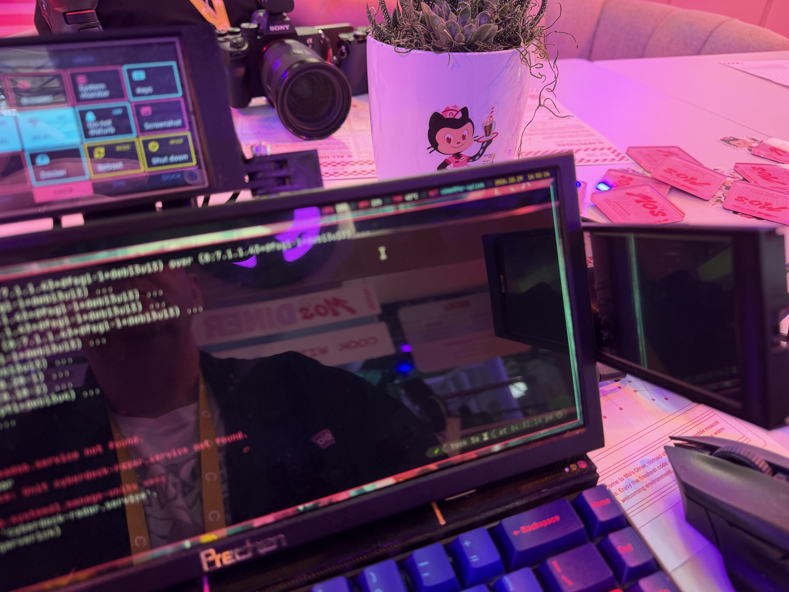
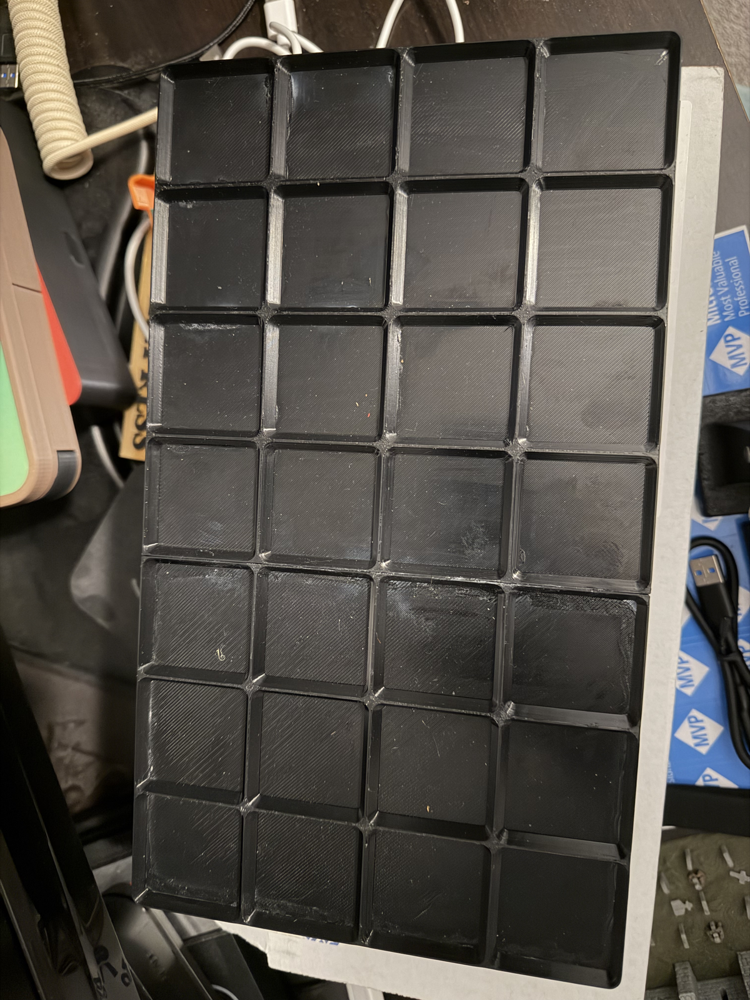
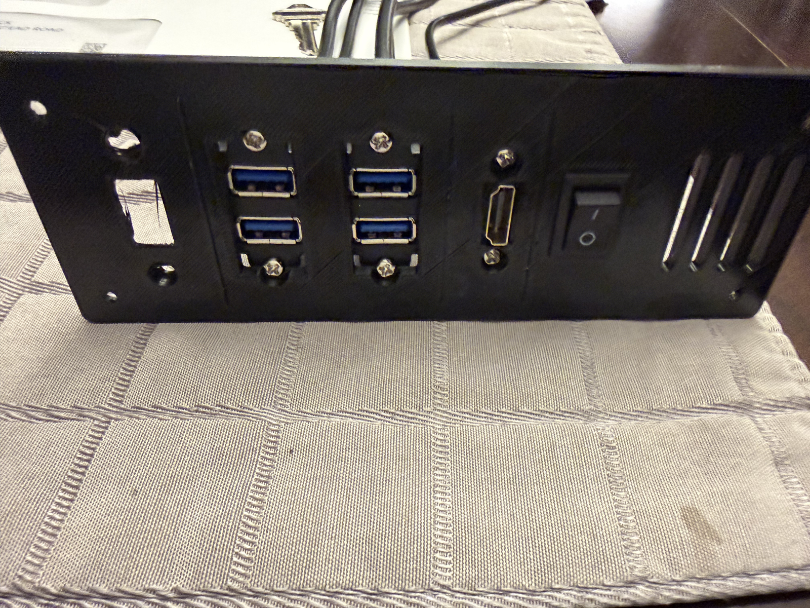
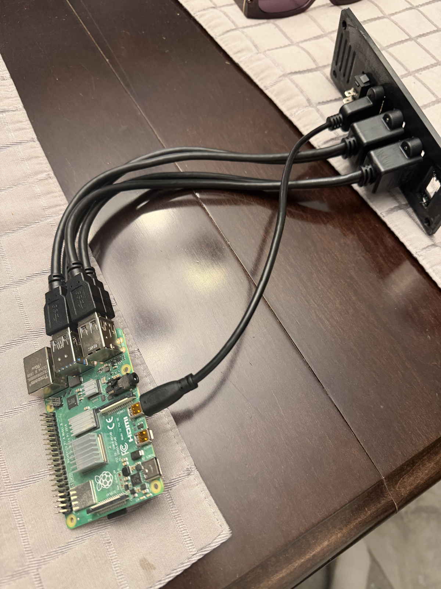
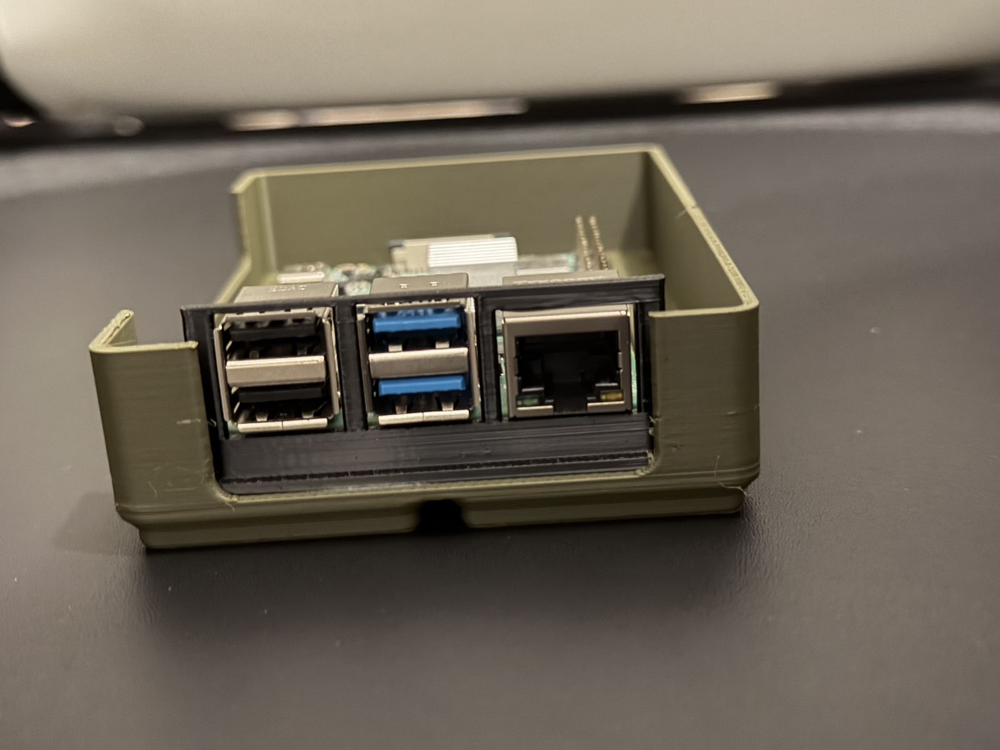

Greetings all! If you stopped by while I had my cyberdeck open at GitHub Universe this year, there's a good chance you asked me one of two questions: how did you build that, and why? I got those questions enough times that it seemed easier to write the whole thing down, so this is the first of a five-part series covering how the deck came together, what went sideways along the way, and where it's headed next.

_Figure 1 – The deck doing its thing at GitHub Universe_

<!-- TODO: Confirm Figure 1 was taken at Universe (Oct 29), and add a line about a conversation or reaction there that stuck with you. -->

Here's how the series breaks down:

1. **Where it started** (this post): the why, and the first round of parts and plans.
2. **[Prototyping](/blog/cyberdeck-part-2-prototyping/)**: displays, power, enclosures, and a lot of PETG.
3. **[The CYD repos](/blog/cyberdeck-part-3-cyd-firmware-repos/)**: the firmware and tooling behind the little touchscreens.
4. **[From Omarchy to i3](/blog/cyberdeck-part-4-omarchy-to-i3/)**: why I ended up on Raspberry Pi OS Lite with i3.
5. **[The VESA redesign and other callouts](/blog/cyberdeck-part-5-vesa-redesign-and-callouts/)**: tearing it up and starting over, plus what I learned.

## Why build a cyberdeck at all?

A cyberdeck is, at its heart, a portable computer you build yourself, usually with a healthy dose of retro-futurist styling and far more exposed hardware than any sane laptop manufacturer would ship. There's no real practical argument for one when a perfectly good laptop is sitting in your bag, and that's sort of the point: it's a project where the journey matters more than the destination.

<!-- TODO: The three reasons below are placeholders inferred from the build, not something you told me. Rewrite them with your own "why": what got you interested, whether a specific deck or piece of media kicked it off, and what you wanted out of it. -->

For me, the appeal came down to three things. First, it's a chance to get hands-on with hardware again, which is something I don't get to do nearly as much as I'd like in my day job. Second, it's a great excuse to put my 3D printer through its paces on something more involved than game pieces. Third, it gave me a home for a pile of small, fun software ideas, like an ADS-B radar scope and a touchscreen control surface, that didn't really have anywhere else to live.

As for the look, I leaned into a _Ghost in the Shell_ aesthetic: black panels with magenta, gold, and white accents, and enough visible circuitry to make it obvious this isn't something you bought off the shelf. More on how those panels were made in part 2.

## The starting lineup

Every build starts with a parts list, and this one started smaller than it ended up. The core of the deck was, and still is, a Raspberry Pi 4. It's not the newest board on the market, but I had one on hand, it's well supported, and it has the I/O I needed without having to chase adapters. The rest of the first-round list looked like this:

- **Compute:** A Raspberry Pi 4 with 4 GB of RAM.
- **Display:** A 13.3" VSDISPLAY panel with a separate driver board (which turned into its own saga, covered in part 2).
- **Power:** An INIU power bank, a rocker switch, and a USB-C breakout board.
- **Input:** A folding Bluetooth keyboard with a built-in trackpad.
- **Fabrication:** My Bambu Lab A1 Mini, printing in PETG.

<!-- TODO: Add anything else from the first parts order that's worth calling out, and the folding keyboard's make/model if you want to name it. -->

## Planning around Gridfinity

One of the first decisions I made was to lay the internals out on a Gridfinity grid. If you haven't run into Gridfinity before, it's an open-source modular storage system built around 42 mm units, and there's a huge library of community bins and baseplates for it. Building on a 7×4 baseplate meant I could treat the inside of the case like a pegboard: the Pi, power bank, and accessories each got their own bin, and moving things around didn't mean reprinting the entire enclosure.

_Figure 2 – The 7×4 Gridfinity baseplate that anchored the original layout_

Of course, a modular interior doesn't do you much good if every cable has to snake out the side of the case. The first real part I designed was a rear I/O panel, which gives the Pi's ports a clean exit through the back wall. It carries four USB 3 passthroughs, an HDMI port, the rocker switch for power, and a set of vents to give the Pi some room to breathe.

_Figure 3 – The rear I/O panel, with USB passthroughs, HDMI, the power switch, and vents_

Behind the panel, short USB extension cables run back to the Pi, so the board itself can sit anywhere on the grid and still reach the outside world.

_Figure 4 – Wiring the Pi's USB ports to the panel passthroughs_

The Pi itself went into a printed case of its own, so it could drop into a Gridfinity bin and come back out again without any fuss.

_Figure 5 – An early printed case for the Pi_

## What I didn't know yet

Looking back at those first few weeks, I had a pretty clear idea of what I wanted the deck to look like, and a much less clear idea of what it would take to get there. The display I started with didn't survive the build, the rocker switch eventually went away, and the Gridfinity layout and its base were scrapped entirely when I redesigned the deck around a VESA mount in October. I also had no idea I'd end up writing firmware for a pair of ESP32 touchscreens, or swapping desktop environments more times than I'd like to admit.

That's the fun of a project like this, though. In the next post, I'll walk through the prototyping phase: getting a display to light up, sorting out power, and printing a lot of parts that didn't survive. Stay tuned!
