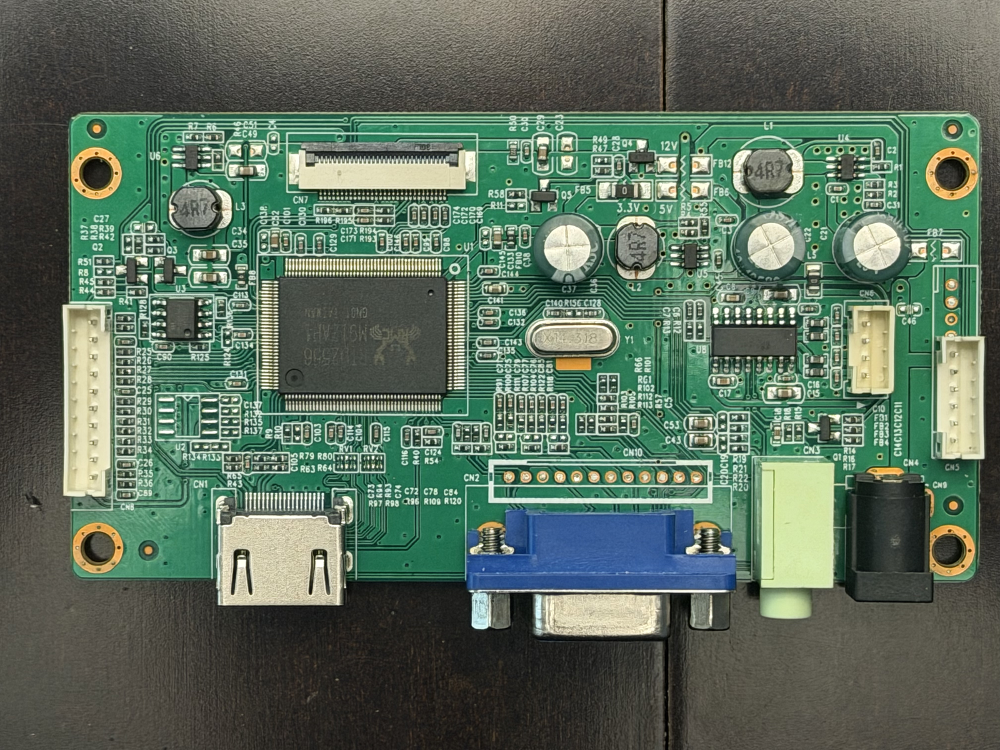
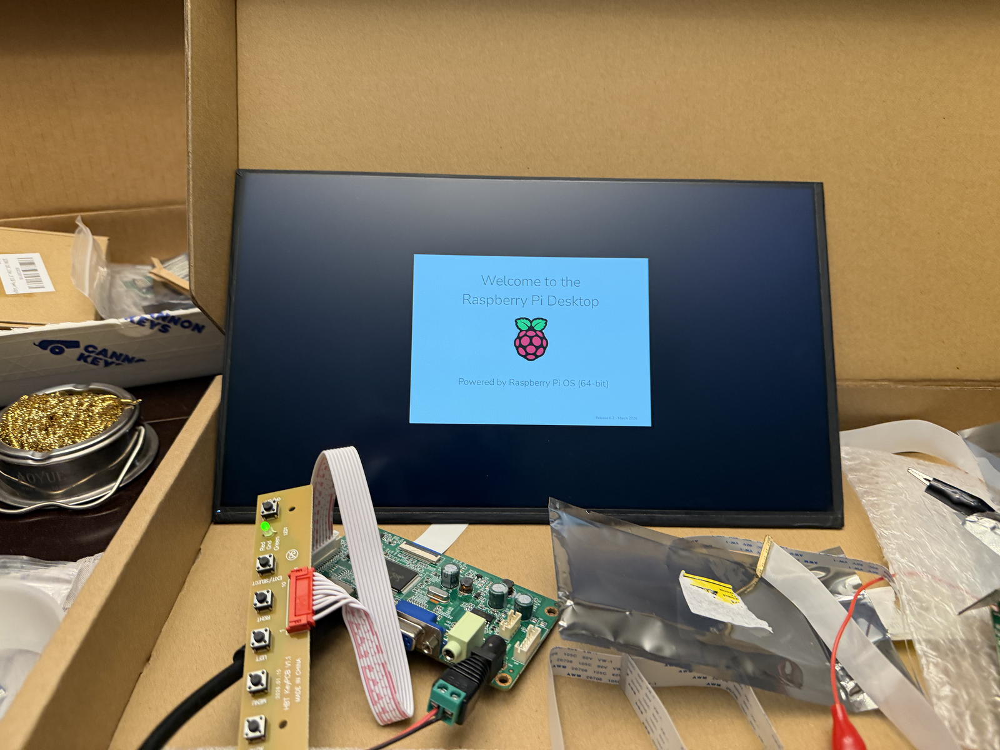
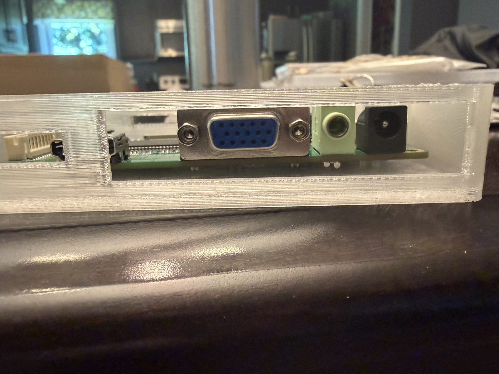
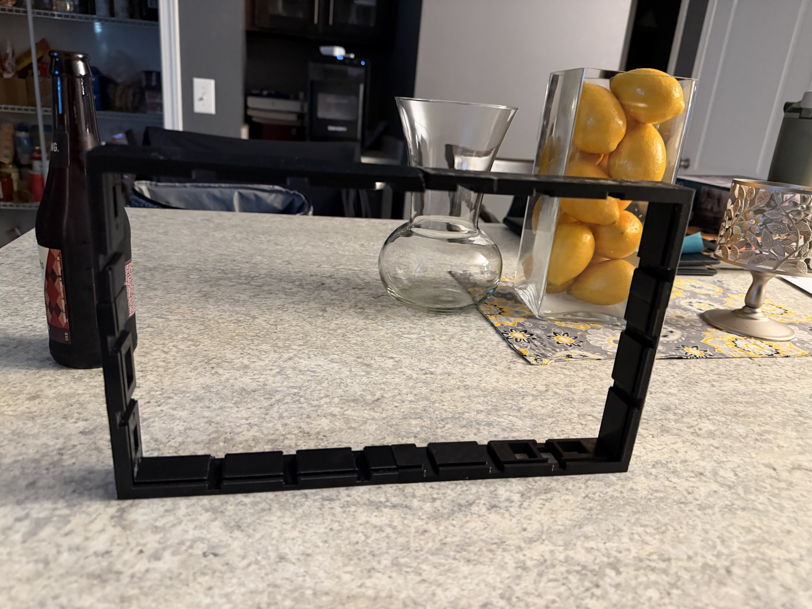
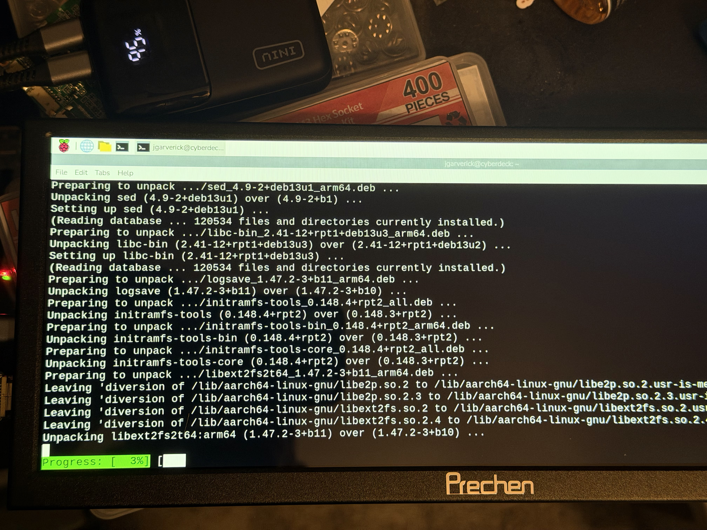
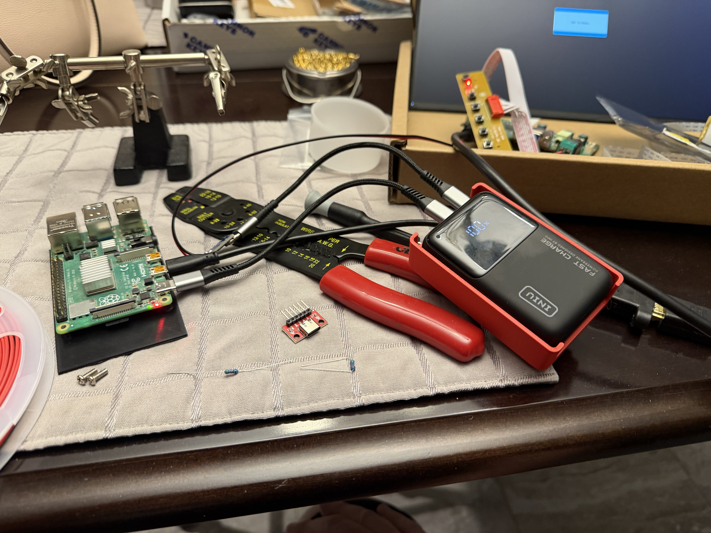
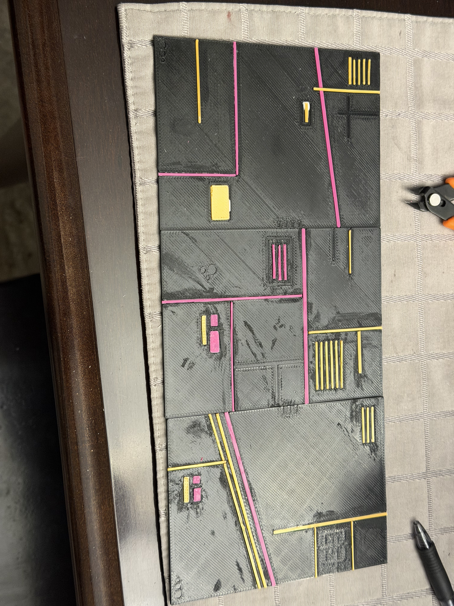
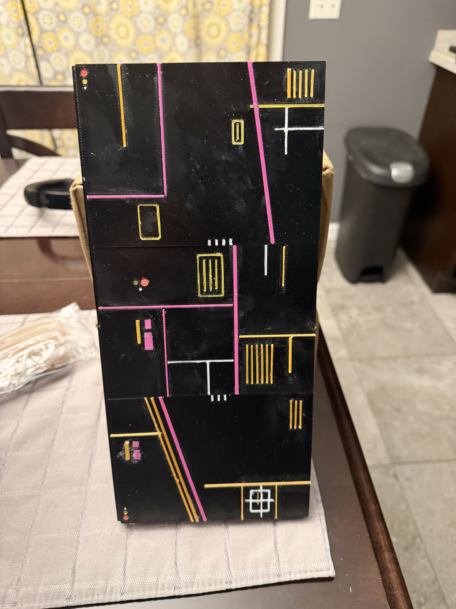

Welcome back! In [part 1](/blog/cyberdeck-part-1-where-it-started/), I covered why I started building a cyberdeck and the parts and plans I started with. This time around, I want to dig into the prototyping phase, which is where most of the real learning happened. There's no substitute for putting parts on a bench and finding out which of your assumptions don't hold up, and I found plenty of those.

Prototyping on this build broke down into three tracks that ran more or less in parallel: the display, the power path, and the enclosure. Each one affected the others, so I'll take them in roughly the order they started to settle.

## Getting a display to light up

The display is the single biggest decision in a cyberdeck, since it drives the size of the case, the power budget, and a good chunk of the look. My first choice was a 13.3" laptop-style panel from VSDISPLAY, which needs a separate driver board to turn an HDMI signal into something the panel understands.

_Figure 1 – The HDMI/VGA driver board for the 13.3" panel_

Getting the Pi, the driver board, and the panel talking to each other for the first time was a genuinely satisfying moment. There's something about seeing the Raspberry Pi desktop come up on a bare panel sitting in its shipping box that makes the whole project feel real.

_Figure 2 – First light on the 13.3" panel_

The driver board needed a home of its own, so I printed a translucent enclosure that kept the board protected while leaving the VGA, audio, and power connectors accessible. I also designed and printed a black bezel frame for the panel itself.

_Figure 3 – A printed enclosure for the driver board_

_Figure 4 – The printed bezel frame for the 13.3" panel_

I designed the panel's enclosure in CadQuery, which I'd recommend to anyone who's more comfortable in code than in a traditional CAD tool. Being able to treat dimensions as parameters made it much easier to iterate when a measurement turned out to be off by a millimeter or two, which, of course, happened more than once. The bracket assembly used heat-set inserts rather than screwing straight into plastic, which is something I'd do again on any part that's going to be taken apart more than a handful of times.

Later on, I also ordered a USB-C eDP controller board from VSDISPLAY (30-pin eDP, 5 V), with the idea of simplifying power to the panel.

### The pivot to a bar display

Of course, prototyping doesn't always go to plan. While I was putting retaining screws into the bottom of the original mounting brackets, I got a little too close to the contacts on the back of the panel, and that was the end of the 13.3" display. With it went the enclosure I'd spent so much time refining.

If you're mounting a bare panel, take the time to map out where its contacts and flex cables sit before you drive a single screw near it, and give yourself more clearance than you think you need. Bare laptop panels have exposed electronics on the back that a metal screw or a slipped driver can short in an instant, and there's no warning before it happens.

Rather than order a replacement, I took the opportunity to rethink the display entirely. In early July, I switched to a 12.3" Prechen HD-123 bar monitor, an ultra-wide, short display that gives the deck a much more distinctive profile. Being a self-contained portable monitor, it also meant one less driver board to house and power.

_Figure 5 – The Prechen bar display's first session, installing packages on the Pi_

The Prechen sits in a modular lid with snap-fit panels, so the veneer panels (more on those shortly) can be swapped without taking the lid apart. To keep the lid and the base connected, I picked up a set of uxcell torque shaft hinges: 304 stainless steel, 0.5 N·m, with a 66 mm length and a 12.8 mm barrel. Torque hinges are worth the small premium over plain hinges, since they hold the display at whatever angle you leave it instead of letting it flop backward.

## Designing the power path

Power is where a lot of DIY builds get into trouble, so I took the time to lay it out before wiring anything. The original design looked like this:

1. An INIU power bank provides the battery.
2. A rocker switch on the rear I/O panel cuts power to everything downstream.
3. A USB-C breakout board, wired with 5.1 kΩ resistors on its CC pins, feeds the Pi.
4. The Raspberry Pi 4 takes 5 V over USB-C.

Why the resistors? A USB-C power source won't put 5 V on the line until it sees a device asking for it, and that request is made by pulling the CC pins down through 5.1 kΩ resistors. Plenty of cheap USB-C breakouts leave those resistors off, and the result is a board that looks wired correctly but never powers up. Be sure to check for them before you start debugging anything else.

_Figure 6 – Bench-testing the power path_

I also built an interactive wiring diagram as a small React component, which turned out to be far more useful than a static sketch. Being able to click through each connection made it easy to double-check the wiring before I committed to crimping anything.

<!-- TODO: Optional: link to or screenshot the React wiring diagram. -->

## Printing the case and the veneer panels

With the internals laid out on the 7×4 Gridfinity baseplate, the case itself came together as a series of prints on the A1 Mini. Every structural part on the deck is printed in PETG, from the baseplate and walls to the brackets, bezels, and panels. PETG was the right call here: it handles the heat coming off the Pi and the power bank better than PLA, and it's a bit more forgiving when you're pressing parts together.

The part of the build I'm happiest with, though, is the set of decorative veneer panels. Each panel has a black PETG base with inlays in magenta, gold, and white, tracing out circuit-style lines and blocks that lean into the _Ghost in the Shell_ look I was going for. The inlay colors are the one place on the deck where I didn't use PETG.

Why the switch? The inlays are purely decorative, so they don't need PETG's durability the way the case and the structural parts do, and I have a ton of colors in PLA on hand. I printed each inlay as a separate PLA part and glued it into its channel in the PETG base. Printing them separately also means there are no filament swaps to manage mid-print, and a bad inlay can be reprinted on its own without throwing away the whole panel.

_Figure 7 – Veneer panels partway through finishing_

_Figure 8 – The finished veneer panels_

Of course, glued-in parts are only as good as the glue job. A few of the inlays have popped out over time, either because I didn't get enough glue behind them or because they got caught on something inside my bag. Rather than reprint those, I used fine-tip paint markers to fill in the gaps. If you try this approach, be sure to rough up both surfaces and use a glue that bonds well to PETG and PLA, and keep a set of paint markers in matching colors for touch-ups on the road.

## What prototyping taught me

If there's one takeaway from this phase, it's that a cyberdeck design isn't done until the parts are in your hands. Measurements from a datasheet can only get you so far, and several of the parts above were reprinted three or four times before they fit. Take the time to print small test pieces for anything with a tight tolerance, like port cutouts or insert holes, before you commit hours of print time to a full panel.

By mid-July, I had a working deck: a Pi 4 running on battery power, a bar display in a printed lid, and a set of panels that made the whole thing look the part. What it didn't have yet was the pair of little touchscreens that ended up getting the most attention at Universe. In [part 3](/blog/cyberdeck-part-3-cyd-firmware-repos/), I'll walk through those Cheap Yellow Displays and the repos I built to hold their firmware. Until next time!
