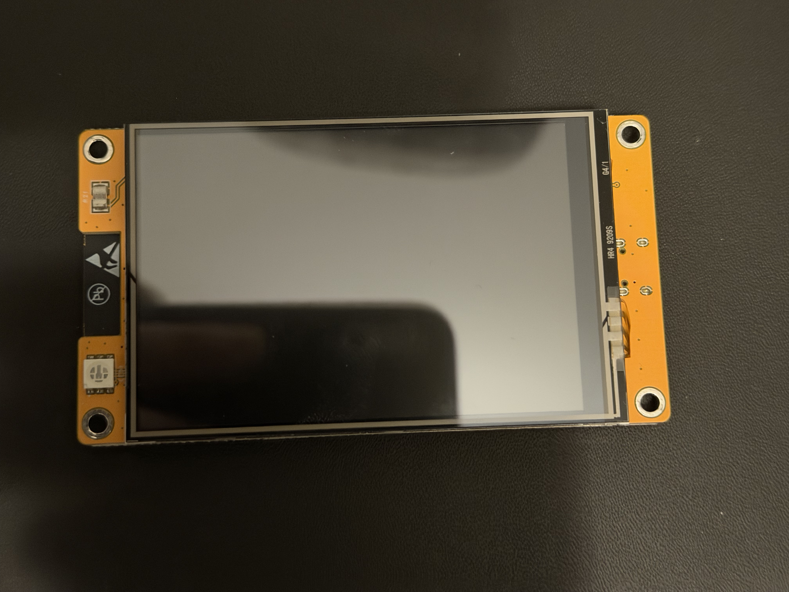
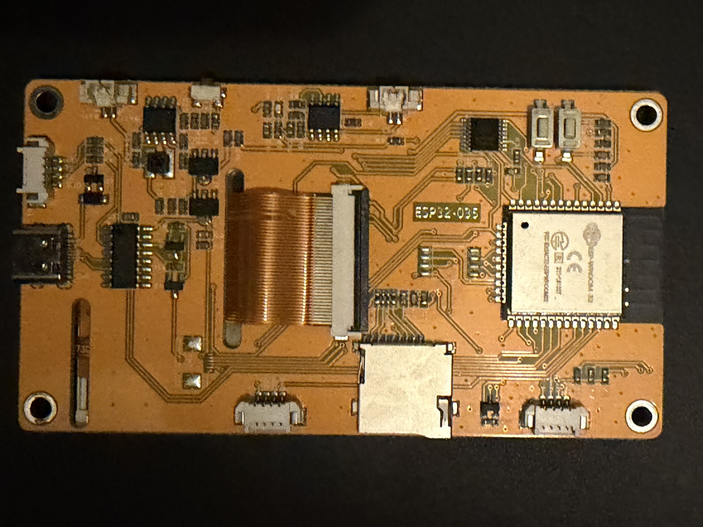
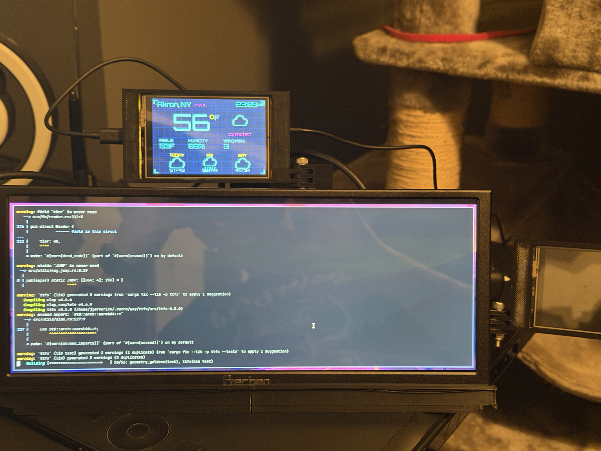
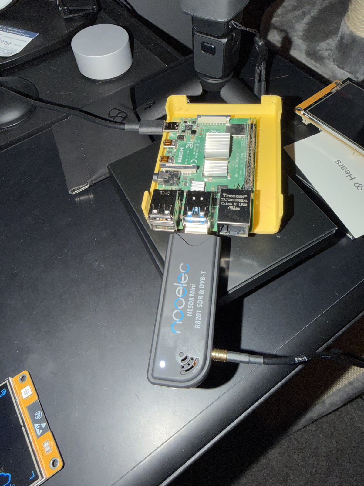
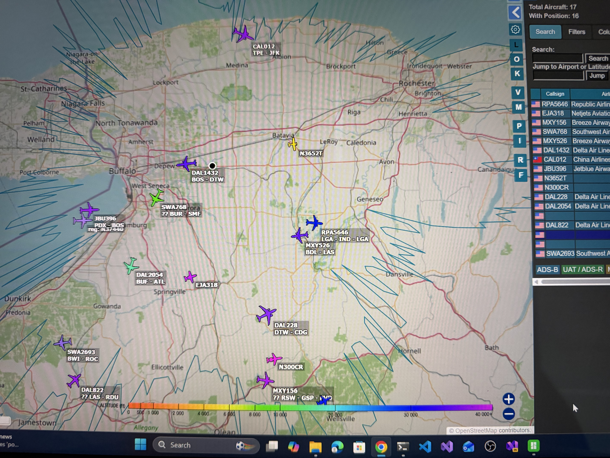
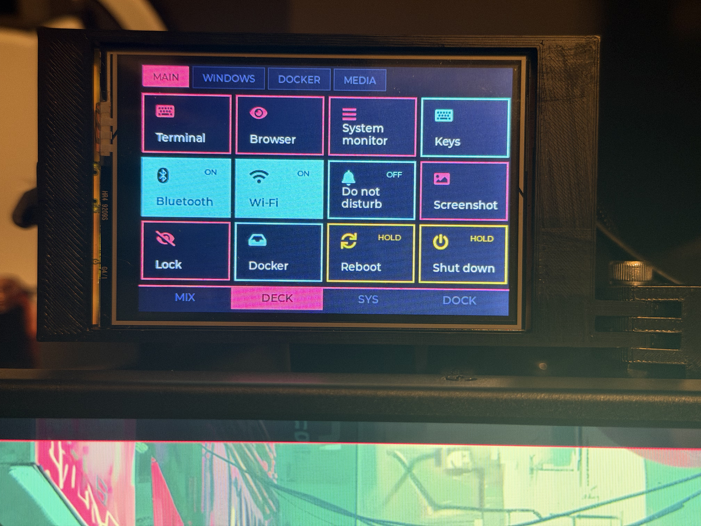
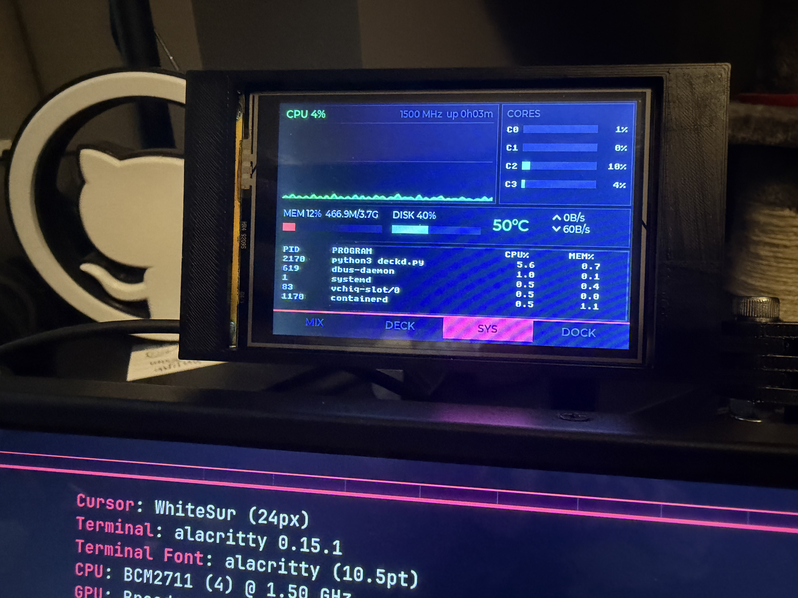

Greetings all! In [part 2](/blog/cyberdeck-part-2-prototyping/), I walked through prototyping the display, power, and enclosure. This post covers the part of the deck that got the most questions at GitHub Universe: the two little touchscreens that sit alongside the main display. They're ESP32 "Cheap Yellow Displays," and they ended up turning a fun hardware build into a fairly involved software project.

## What's a Cheap Yellow Display?

"Cheap Yellow Display," or CYD, is the community nickname for a family of ESP32 development boards with a touchscreen bolted on, named for their yellow PCBs and their very reasonable price. The boards on my deck are the ESP32-3248S035R, which pairs an ESP32 with a 3.5" 320×480 ST7796 display, resistive touch, and an onboard SD card slot.



_Figure 1 – The front of the ESP32-3248S035R_



_Figure 2 – The back of the board, with the ESP32 module and SD slot_

Why put a second computer on a cyberdeck that already has a Raspberry Pi? Each CYD runs its own firmware and can draw its own interface without stealing screen space or CPU time from the main display. That makes them a great fit for glanceable, always-on information, like weather, system stats, or a radar scope, and, as it turned out, for a touch-driven control surface.

## How I set up the repos

I build all of the CYD firmware with PlatformIO in VS Code, and I've published three of the projects as public repos: [`cyberdeck-tft-wxpanel`](https://github.com/jgarverick/cyberdeck-tft-wxpanel), [`cyberdeck-tft-radar`](https://github.com/jgarverick/cyberdeck-tft-radar), and [`cyberdeck-tft-4pan`](https://github.com/jgarverick/cyberdeck-tft-4pan). The weather panel and radar scope follow the same basic pattern, and the control surface builds on it, so I'll start with the shared decisions that are worth calling out if you're starting a CYD project of your own.

### Keep the display config in `platformio.ini`

The usual way to configure the TFT_eSPI library is to edit its `User_Setup.h` file, which lives inside the library itself and gets wiped out every time the library updates. Instead, both repos pass the entire display configuration as build flags, so the setup lives in the repo and travels with it. The relevant section of the radar's `platformio.ini` looks like the following:

```ini
build_flags =
    -D USER_SETUP_LOADED=1
    -D ST7796_DRIVER=1
    -D TFT_WIDTH=320
    -D TFT_HEIGHT=480
    -D TFT_MISO=12
    -D TFT_MOSI=13
    -D TFT_SCLK=14
    -D TFT_CS=15
    -D TFT_DC=2
    -D TFT_BL=27
    -D USE_HSPI_PORT=1
    -D TOUCH_CS=33
```

Setting `USER_SETUP_LOADED` tells TFT_eSPI to skip its own setup file and trust the flags. Since every CYD on the deck uses the same board, this block is identical across the TFT_eSPI projects, which makes spinning up a new one a matter of copying a file.

### Use a dev container for the toolchain

The weather and radar repos each include a dev container with the PlatformIO and container tools extensions preinstalled, so I can open any of them on any machine and get the same toolchain. The radar repo also mounts the host's Docker socket into the container, which lets me build and run the feed service (more on that shortly) from the same environment I'm writing firmware in. Both repos also have Dependabot configured to keep dependencies current.

### Put runtime config on the SD card

Hard-coding Wi-Fi credentials into firmware works right up until you change networks. Both projects read an INI file from the SD card at boot and fall back to defaults in `main.cpp` for anything missing. That means I can move the deck from home to a conference venue by editing a text file instead of reflashing. The weather panel's config looks like this:

```ini
wifi_ssid=MyWifi
wifi_pass=MyPassword

# 0=MANUAL, 1=IP, 2=WIFI triangulation
location_mode=2

use_fahrenheit=true
tz_string=EST5EDT,M3.2.0,M11.1.0
```

### Ship real fonts with LittleFS

The look of these panels matters as much as the data, so both projects render in Orbitron when its `.vlw` font files are present on the board's LittleFS partition, and fall back to the built-in and seven-segment fonts when they aren't. The weather repo includes `make_vlw.py`, a small script that rasterizes any TTF straight into TFT_eSPI's VLW format, so you don't need the Processing IDE to generate fonts. The flash order is fonts first, then firmware:

```bash
pio run -t uploadfs
pio run -t upload
```

## The weather panel

The weather panel pulls current conditions and a three-day forecast from Open-Meteo, which doesn't require an API key, and renders them as a neon dashboard. It can also figure out its own location, either from its IP address or by Wi-Fi triangulation through BeaconDB, so the forecast follows the deck around without any extra configuration.



_Figure 3 – The weather panel mounted above the main display_

## The ADS-B radar scope

The radar scope is the one that drew a crowd. It renders a sweeping radar display of the aircraft overhead, fed by an ADS-B receiver on the Pi. The repo holds more than just firmware, since the data has to come from somewhere:

- **`main.cpp`:** The ESP32 firmware for the scope, with three visual profiles (Classic, CRT, and Fast) that you can switch between over serial.
- **`radar_feed.py`:** A small HTTP service that reads the decoder's `aircraft.json`, works out range and bearing from a home location, and serves a compact payload at `/radar`.
- **`mock_adsb.py`:** An ADS-B emulator, so I could build and test the scope without an antenna.
- **`Dockerfile` and `docker-compose.yml`:** A containerized runtime for the decoder and feed service.
- **`install-adsb.sh`:** An install script that sets up the RTL-SDR drivers, readsb, optional tar1090, and a systemd service for the feed on the Pi.

The emulator ended up being one of the most useful pieces of the whole project. Resist the urge to develop against live data from the start; having a predictable set of fake aircraft made it far easier to get the sweep and the plotting right before I ever plugged in a radio.

On the hardware side, the receiver is an RTL-SDR Blog V4 dongle, which is what the install script sets up drivers for. Early testing used a Nooelec NESDR SMArt.



_Figure 4 – Early ADS-B testing on the Pi with a Nooelec SDR_

<!-- TODO: Confirm the Nooelec-to-RTL-SDR Blog V4 order, or adjust if you used both for different reasons. -->

Comparing the scope against tar1090's map was how I checked that the positions were landing where they should. Western New York has a surprising amount of traffic overhead at any given moment.



_Figure 5 – The radar scope next to tar1090's map of the same aircraft_

The scope polls the feed service over Wi-Fi, using the Pi's host and port from the SD card config, which does mean it needs a network to join at a venue. So far, the control surface is the only CYD on the deck that talks to the Pi over serial.

## The control surface: `cyberdeck-tft-4pan`

The other CYD started life as a HUD for system stats and grew into a full control surface for the deck, which lives in its own repo, [`cyberdeck-tft-4pan`](https://github.com/jgarverick/cyberdeck-tft-4pan). Internally, I call it `cyd-deck`. It's the most involved of the three projects, since it's really two programs that have to agree with each other: firmware on the CYD, and a Python service on the Pi called `deckd`.

The CYD shows four pages, which you switch between with the tab bar or the board's BOOT button:

- **MIX:** An output device selector, plus faders, mute buttons, and level meters for the master volume, up to three apps, and the mic.
- **DECK:** A 4×3 grid of Stream Deck-style buttons, organized into banks.
- **SYS:** A btop-style system monitor with CPU history, per-core bars, memory, disk, temperature, network, and the top five processes. Tapping a process ends it.
- **DOCK:** The Docker containers on the Pi, with their state, CPU, and memory. Tapping one opens start, stop, restart, and recent logs.



_Figure 6 – The MAIN bank on the DECK page_



_Figure 7 – The SYS page, with `deckd.py` showing up in its own process list_

The repo is split into four folders, each with one job:

| Folder | Contents |
| --- | --- |
| `firmware/` | The PlatformIO project for the CYD, built on LVGL 8.3, LovyanGFX, and ArduinoJson |
| `deckd/` | The Python service for the Pi, with its default `deck.json`, a systemd unit, and an installer |
| `sim/` | A desktop simulator that compiles the real UI code, for screenshots and testing without the board |
| `tests/` | End-to-end tests that run `deckd` and the simulator over a virtual serial cable |

Unlike the other two projects, the control surface uses LVGL and LovyanGFX rather than TFT_eSPI. LVGL brings proper widgets, like faders, tab bars, and buttons, which would have been a lot of work to draw by hand for an interface this busy.

### A simple serial protocol

The CYD and `deckd` talk over USB serial at 921600 baud, exchanging one JSON object per line. Every message has a `t` field that names its type, and either side ignores types it doesn't recognize, so I can add messages to one side without breaking the other. The CYD sends things like `btn` when a button is pressed or `vol` when a fader moves, and `deckd` sends things like `sys` for system stats, `dock` for containers, and `theme` for the color palette. A heartbeat keeps a link watchdog on the CYD happy, and the screen shows a **NO LINK** indicator if `deckd` goes quiet. I documented the full protocol in `deckd/PROTOCOL.md`, which has paid for itself every time I've come back to the code after a few days away.

### Event-driven instead of polling

The first version of `deckd` polled for everything on a timer. I've since reworked it to be event-driven wherever the Pi offers events, so the screen updates when something actually changes. The mixer follows `pactl subscribe`, the DOCK page follows Docker's `/events` stream, and toggle buttons can follow a long-running watch command, like `gdbus monitor` on NetworkManager or BlueZ. Each event source runs as a supervised watcher that reconnects with a backoff, and while a source is down, `deckd` falls back to slow polling for just that data. Things that have no change events, like CPU and memory, are still sampled, but only quickly while their page is visible.

### Buttons in a JSON file

The DECK buttons are defined in `~/.config/deckd/deck.json` on the Pi, and the CYD picks up changes within a couple of seconds of saving the file, with no reflashing. A button can run a shell command, flip a toggle, jump to another page, send an i3 command, or publish to MQTT, which makes it easy to drive Home Assistant scenes from the deck. Commands stay on the Pi; the CYD only ever learns the labels, icons, and colors. Destructive buttons, like Reboot and Shut down, use the `confirm` type, which means they only fire after a press and hold. A Wi-Fi toggle, for example, looks like the following:

```json
{ "label": "Wi-Fi", "icon": "wifi", "type": "toggle",
  "state": "[ \"$(nmcli radio wifi)\" = enabled ]",
  "on": "nmcli radio wifi on", "off": "nmcli radio wifi off",
  "watch": "gdbus monitor --system --dest org.freedesktop.NetworkManager --object-path /org/freedesktop/NetworkManager" }
```

A few other touches are worth calling out. The CYD's colors follow the desktop theme, and they switch automatically when I change themes on the Pi. The board's RGB LED turns red when the Pi hits 75 °C, starts throttling, or has an unhealthy container, so I can tell at a glance when something needs attention. The repo also holds `deck-keys.py`, the keybinding viewer I'll talk about in part 4.

### Testing without the board

The simulator and tests are the parts of this repo I'd point to if someone asked how to keep an embedded project sane. The simulator compiles the real `ui.cpp` against LVGL on the desktop, so I can render every page as a screenshot without touching the hardware. The end-to-end tests connect `deckd` to the simulator over a virtual serial cable, with fake stand-ins for PipeWire and Docker, and a second test covers the event paths, MQTT, and crash recovery. It's the same lesson as the ADS-B emulator, taken a step further.

The DECK page also has a WINDOWS bank for managing windows, which only made sense once I'd settled on a window manager. That's a story for the next post.

<!-- TODO: Optional: add a simulator screenshot, and say whether the HUD firmware will be published. -->

## Wrapping up

If you take one thing from this post, it's that a CYD project is worth treating like any other software project: put the config in the repo, give it a reproducible dev environment, and build yourself a way to test without the real hardware. It costs a little time up front and pays for itself the first time you need to change something at a conference table.

In [part 4](/blog/cyberdeck-part-4-omarchy-to-i3/), I'll cover the operating system side of the deck, including why I tried Omarchy first and why I ended up on Raspberry Pi OS Lite with i3. Happy hacking!
