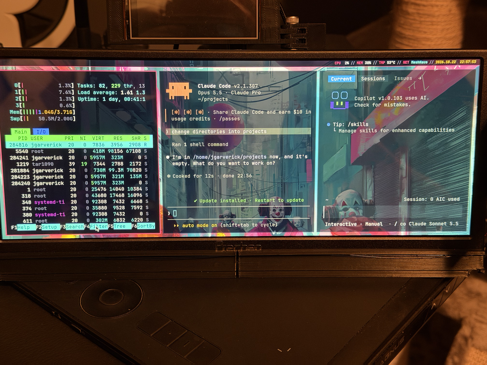
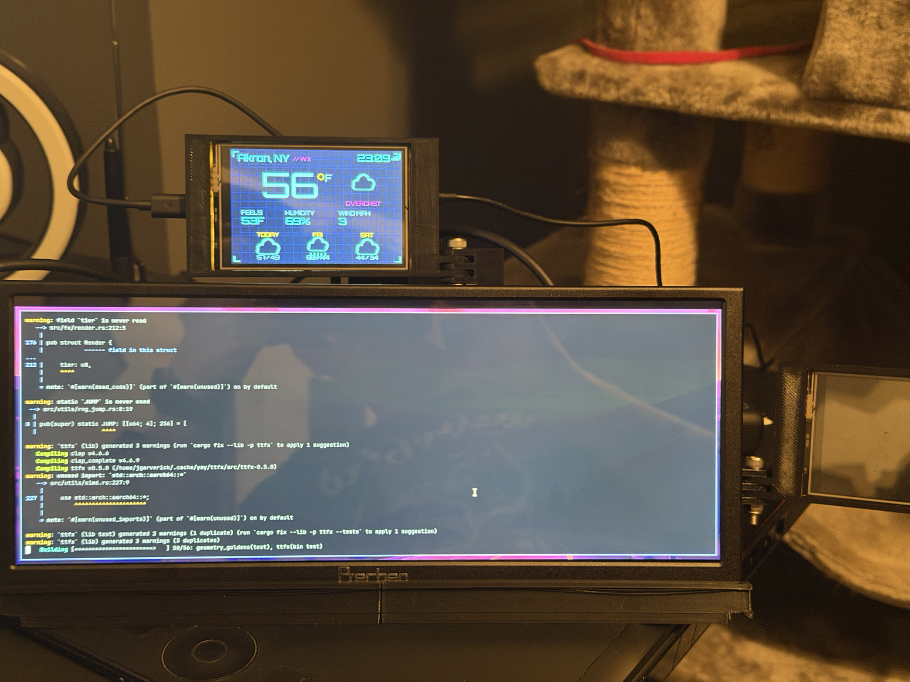
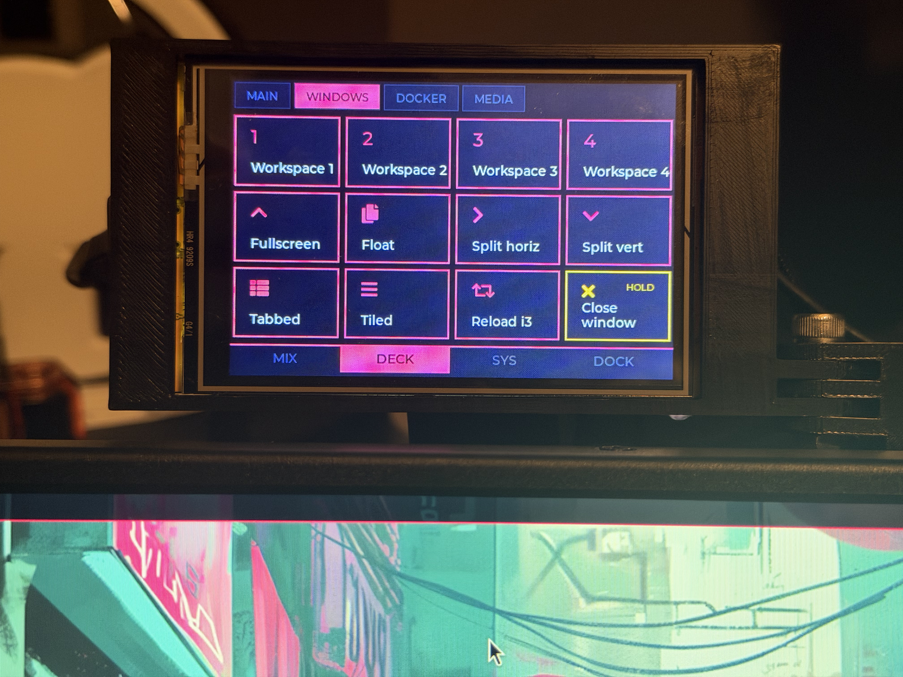

Welcome back! So far in this series, I've covered [where the deck started](/blog/cyberdeck-part-1-where-it-started/), [the prototyping phase](/blog/cyberdeck-part-2-prototyping/), and [the CYD firmware repos](/blog/cyberdeck-part-3-cyd-firmware-repos/). This post is about software of a different kind: the operating system and desktop that run on the Pi itself. Choosing an OS for a cyberdeck is as much about feel as it is about function, and I went through a few options before landing on something that felt right.

## The starting point

When the Prechen display first came online in July, the Pi was running the standard Raspberry Pi OS with its default Pixel desktop. That was the right call for prototyping, since it's the most heavily supported option for the hardware and everything just works. It's also, frankly, a little plain for a deck that's supposed to look like it walked out of a cyberpunk anime. What I wanted was something lightweight, ideally Debian-based, with a look I could make my own.

## Why Omarchy?

Omarchy is DHH's opinionated Linux setup, built on Arch Linux and the Hyprland tiling compositor, with a curated set of tools, keybindings, and themes that look great out of the box. If you've seen screenshots of a slick, keyboard-driven Linux desktop over the past year, there's a decent chance it was Omarchy. It's built around the same ideas I wanted for the deck: tiling windows, a keyboard-first workflow, and a strong visual identity.

<!-- TODO: Add what drew you to Omarchy specifically, if anything beyond the above. -->

### Why it didn't stick

In short, the Pi 4 support was buggy. Omarchy was built with x86 laptops in mind, and running it on a Raspberry Pi 4 means stepping off the well-traveled path; as of late October 2026, Omarchy's ARM support only ships on its edge channel, the testing channel where new packages land first. I could live with a few rough edges, but the final straw was running `omarchy update` and watching it break a whole series of things that had been working fine moments before.

I'll be honest: at that point, I got fed up. Rather than spend another evening untangling a rolling-release update on hardware the project doesn't really target, I wiped the card and started over with something I knew would be stable on the Pi. Granted, Omarchy is a great setup on the hardware it's built for, and I'd happily run it on an x86 laptop. On a Pi 4 that I need to work when I open it at a conference, though, an update that can break the desktop is a deal-breaker.

<!-- TODO: Optional: add one or two specifics on what the update broke (display, input, audio, packages) if you remember them. -->

## Landing on Raspberry Pi OS Lite and i3

Where I ended up was Raspberry Pi OS Lite (64-bit), which ships with no desktop at all, with i3 on top. Starting from Lite means I only install what I actually use, and the Debian base means the Pi's hardware support comes along for free, with updates that don't keep me up at night. i3 gives me the tiling, keyboard-driven workflow I liked about Omarchy, without the GPU demands of a Wayland compositor like Hyprland.

Why i3 specifically? There are three reasons it fits this deck well:

- **It's light.** i3 uses next to nothing in the way of memory or CPU, which leaves the Pi's 4 GB for Docker, the ADS-B decoder, and `deckd`. At idle, the deck sits under 500 MB of memory used.
- **It suits the display.** The Prechen is an ultra-wide, short display, and that shape is awkward for overlapping windows. Tiling side-by-side panes uses every bit of that width.
- **It's scriptable.** Every i3 action is a command you can send from outside the window manager, which turned out to be the key to tying it into the control surface.



_Figure 1 – A typical i3 layout on the deck, with btop, Claude Code, and GitHub Copilot CLI side by side_

### Building out the desktop

i3 on its own is a window manager, not a desktop, so the rest of the experience comes from a handful of small tools that each do one job:

| Tool | Role |
| --- | --- |
| i3 | Tiling window manager |
| polybar | The status bar along the top of the screen |
| rofi | App launcher and window switcher |
| picom | A lightweight X compositor for transparency and shadows |
| dunst | Desktop notifications |
| Alacritty | The terminal |

Getting the base packages onto a fresh Lite install takes a single command:

```bash
sudo apt install --no-install-recommends xserver-xorg xinit i3 polybar rofi picom dunst alacritty
```

<!-- TODO: Replace the command above with the exact package list you installed if it differs, and consider linking your i3 config or dotfiles. -->

From there, it's all theming. I built two themes for the deck: "Neon//Deck," a neon magenta and cyan look that matches the veneer panels, and a theme based on my board game, _Clown Migration Plan_, for when I want something a little less serious. There's also an Openbox and tint2 add-on for the times I want a floating-window session instead of tiling.



_Figure 2 – The Neon//Deck theme in action_

<!-- TODO: Optional: add a screenshot of each theme, especially the Clown Migration Plan one. -->

### Keybindings you can actually remember

The downside of a keyboard-first desktop is remembering all of the keyboard. My i3 config is full of custom `bindsym` launchers, so I annotate each binding with a comment in the style that Regolith's Remontoire reads, and wrote a small viewer, `deck-keys`, that turns those comments into an on-screen cheat sheet. It lives in the [`cyberdeck-tft-4pan`](https://github.com/jgarverick/cyberdeck-tft-4pan) repo, and there's a Keys button on the control surface that opens it. If you go down the i3 road, take the time to document your bindings as you add them; future you will be grateful.

One binding gets more use than any other: a launcher that opens Claude Code in an i3 scratchpad, so it drops down over whatever I'm working on and gets out of the way just as quickly. I've also installed Ollama on the deck for running small models locally, which I'll come back to in part 5.

<!-- TODO: Optional: share a few of your favorite bindings, and anything you learned about key combos i3 can't capture. -->

### Backup desktops

After the Omarchy experience, I wanted a fallback in case I ever broke my i3 setup, so I also installed KDE Plasma and XFCE as backup sessions, with lightdm as the display manager for choosing between them. Getting lightdm to play nicely took some work, since I had to sort out a few display manager boot issues before the deck would start cleanly. Of the two, XFCE is the lighter option; Plasma is far more polished, but it brings a lot of desktop that a 12.3" bar display doesn't have room for, and every bit of memory it uses is memory that Docker and the ADS-B stack don't get. Day to day, I'm in i3, but it's nice to know there's a working desktop one login away if I need it.

## Wiring i3 into the control surface

Here's where the OS choice and the CYDs come together. The control surface's DECK page has a WINDOWS tab with buttons for the most common i3 actions, so I can manage windows from the touchscreen without reaching for a key combination.



_Figure 3 – The WINDOWS tab on the control surface_

Each button corresponds to a standard i3 command:

| Button | i3 command |
| --- | --- |
| Workspace 1 to 4 | `workspace number 1` through `workspace number 4` |
| Fullscreen | `fullscreen toggle` |
| Float | `floating toggle` |
| Split horiz and Split vert | `split h` and `split v` |
| Tabbed | `layout tabbed` |
| Tiled | `layout toggle split` |
| Reload i3 | `reload` |
| Close window (hold) | `kill` |

These all live in the WINDOWS bank of `deck.json`, where a button can carry an `i3` field instead of a shell command. Workspace 2, for example, is nothing more than this:

```json
{ "label": "Workspace 2", "icon": "2", "i3": "workspace number 2" }
```

When I tap a button, the CYD tells `deckd` which button was pressed over USB serial, and `deckd` passes the matching command to i3. Destructive actions like closing a window, rebooting, or shutting down use the `confirm` button type, which needs a press and hold; that's saved me from more than one accidental tap.

## Lessons from the OS shuffle

Looking back, the biggest lesson here is to match the software to the hardware you actually have, not the hardware in the screenshots. Omarchy and Plasma are both excellent, and on a different machine I might well have stuck with either. On a Pi 4 with a bar display and a pile of background services, though, a minimal Debian base with a handful of small, well-themed tools was the right fit, and it still feels like mine.

In the final post of the series, [part 5](/blog/cyberdeck-part-5-vesa-redesign-and-callouts/), I'll cover the October redesign around a VESA mount, a few notable callouts from the build, and what's coming next. Enjoy!
