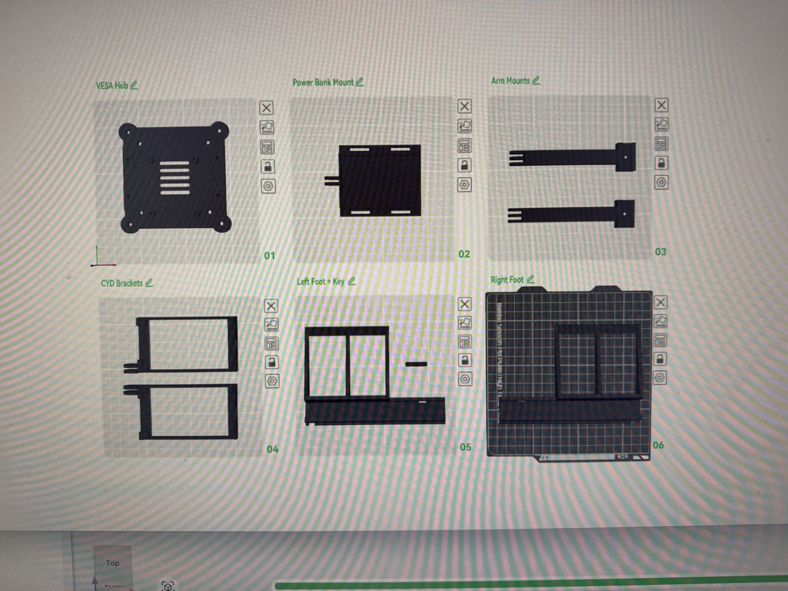
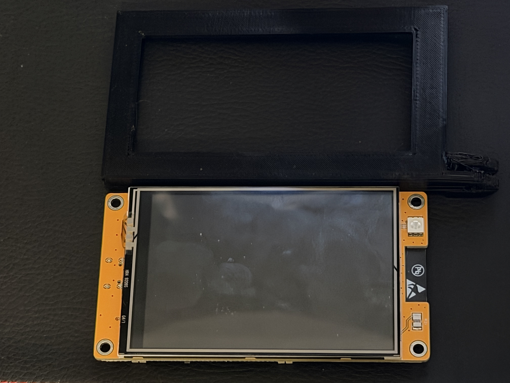
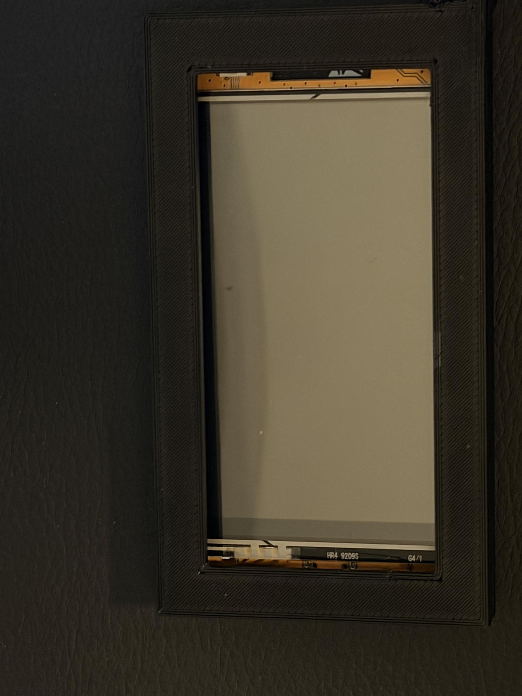
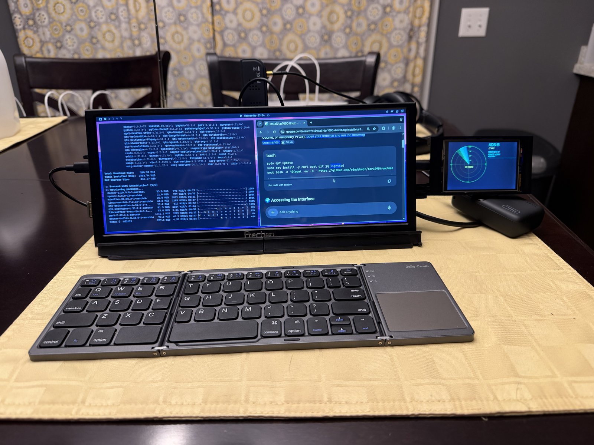
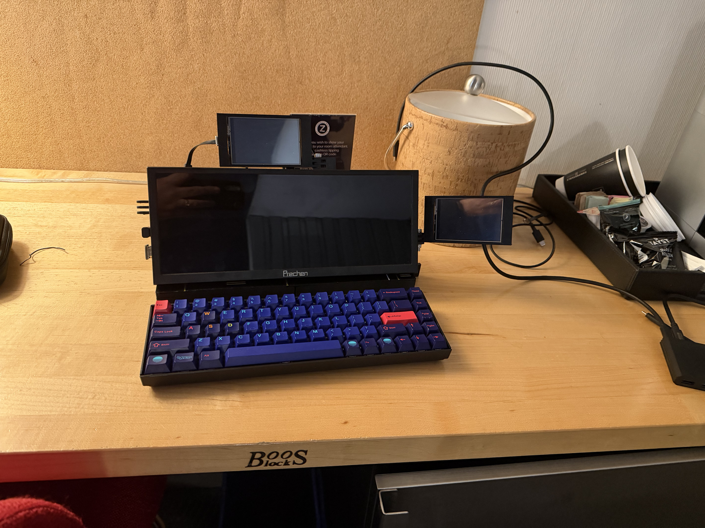
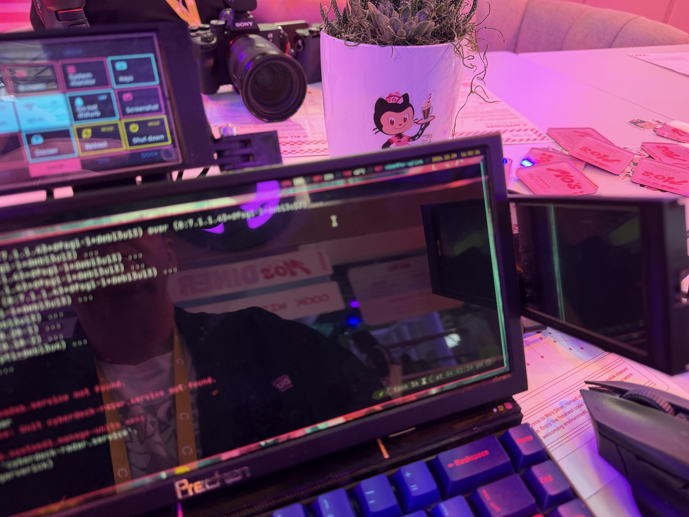

Greetings all, and welcome to the last post in my cyberdeck series! We've covered [where it started](/blog/cyberdeck-part-1-where-it-started/), [prototyping](/blog/cyberdeck-part-2-prototyping/), [the CYD repos](/blog/cyberdeck-part-3-cyd-firmware-repos/), and [the move from Omarchy to i3](/blog/cyberdeck-part-4-omarchy-to-i3/). This one wraps things up with the biggest hardware change of the whole build, a handful of callouts that didn't fit neatly anywhere else, and a look at where the deck goes from here.

## Starting over with a VESA mount

There's a point in most projects where you realize the design you've been refining isn't the design you actually want. For me, that point came in October. The Gridfinity layout from part 1 was great for moving parts around on the inside, but the case built around it had two problems I couldn't print my way out of. The side walls weren't reliable, and they kept coming apart, which is the last thing you want from something you're carrying to a conference. The whole thing was also way too bulky; between the large base, the lid, and the hinges, it had drifted a long way from the portable deck I had in mind.

Before committing to a full redesign, I explored a couple of options that stayed closer to the original. One was a rear wall with cutouts for the Pi's ports; another was a 4×4×3u Gridfinity bin that would hold the Pi and its cabling as a single module. Both would have shored things up, but neither fixed the bulk, since both kept the deck tied to a big base that the display had to sit on.

So I ditched the Gridfinity layout and the larger base, and started over. The new design is built around a VESA plate on the back of the Prechen display, and everything else hangs off that plate. The Pi, the power bank, the CYDs, and the other accessories all mount to the back of the screen, which means the "deck" is now really just the display and whatever keyboard I set in front of it.

_Figure 1 – The parts for the VESA redesign, laid out for printing_

The redesign breaks down into a small set of parts, each with one job:

- **VESA hub:** The central plate that bolts to the display's VESA mount and anchors everything else.
- **Power bank mount:** A cradle that holds the INIU power bank against the hub.
- **Arm mounts:** Two swinging arms that reach out from the hub, so the CYDs can sit alongside the display or fold back behind it.
- **CYD brackets and bezels:** Frames that hold each CYD and give it a finished edge.
- **Left and right feet:** Stands that hold the display upright on a table, including a kickstand foot with LEDs built in.

The hub also handles cable management, which matters more than you'd think once a Pi, a power bank, two CYDs, and an SDR are all hanging off the back of a screen.

_Figure 2 – A CYD and its new printed bezel_

_Figure 3 – The bezel with the CYD seated_

The result is a deck that's much quicker to set up and tear down, and much easier to change. Adding a new accessory now means printing one bracket, not reworking a baseplate.

_Figure 4 – The deck after the VESA redesign_

_Figure 5 – The current setup, with a CYD on each side_

<!-- TODO: Add how long the redesign took, and whether the VESA hub design is something you plan to share (Printables, MakerWorld, or a repo). -->

## Other callouts

A few things from the build are worth calling out on their own, even if they didn't need a full post.

### The rocker switch is gone

Once everything moved to the VESA mount, the rocker switch from the original power design didn't have a natural home anymore, and I found I didn't miss it. These days, turning the deck on means plugging it into the INIU power bank, and turning it off means unplugging it when I'm done. The one catch is remembering to shut down the OS first, since pulling power on a running Pi is a good way to corrupt an SD card. The hold-to-confirm Shut down button on the control surface makes that easy to do, assuming I remember to press it.

It's a good reminder that a part that made sense in one design doesn't automatically earn a spot in the next one.

### Docker on the Pi changed what the deck is for

Running Docker directly on the Pi turned the deck from a novelty into something genuinely useful. The ADS-B feed runs in a container, the control surface reports on every container from its DOCK page, and spinning up a quick service for a demo is just a `docker compose up` away. If you're building a deck of your own, don't shy away from treating it like a small server as well as a terminal.

### Test with fakes before you test with hardware

I mentioned this in part 3, but it bears repeating. The ADS-B emulator saved me hours of debugging, since I could work out the radar scope's behavior against a predictable set of aircraft before I ever plugged in an antenna. The same idea applies to the control surface: get the interface working against known data first, then connect it to the real thing.

### Print small, then print big

Nearly every large part on this deck was reprinted at least once. Take the time to print a thin slice of anything with a tight fit, like a port cutout, an insert hole, or a CYD bezel, before you commit to a print that takes hours.

<!-- TODO: Add any other callouts from the build that people asked about at Universe. -->

## Taking it to GitHub Universe

Bringing the deck to GitHub Universe was the real test of the VESA redesign: it had to travel, set up quickly on a conference table, and survive being poked at by a lot of curious people. It held up well, and the conversations it started are the reason this series exists.

_Figure 6 – The deck at GitHub Universe_

<!-- TODO: Add a line or two about the questions people asked most, or a favorite moment from showing it off. -->

## What's next

A cyberdeck is never really finished, and I already have a list of things I'd like to try. At the top of that list is local AI. Ollama is already on the deck (I also looked at llama.cpp), but the Pi's CPU can only do so much on its own. I've been experimenting with the ASUS UGen300, a USB accelerator built around the Hailo-10H, and I'd like to see how well it can run small models alongside everything else on the deck. That would open the door to on-device assistants and inference without leaning on the cloud, which feels like exactly the kind of thing a cyberdeck should be able to do.

Why not just move to a Raspberry Pi 5? I did consider it, but the price of a Pi 5 is hard to justify when the Pi 4 is handling everything I've thrown at it so far. If I need more compute, I'm more tempted by a dual Pi 4 variant, with two boards talking over a direct Ethernet link and splitting the work between them.

A few smaller items are on the list as well:

- **Addressable LEDs:** I'm wiring a three-wire addressable LED strip to the Pi's GPIO pins, which should give the deck some lighting that can react to what it's doing.
- **An SSH QR code:** Connecting to the deck from my phone or laptop at a venue means hunting for its IP address. The plan is to use qrencode and Conky to put a self-updating QR code for the SSH connection right on the wallpaper.

<!-- TODO: Add anything else on the roadmap, such as publishing the HUD firmware or new CYD panels. -->

Thanks for following along with this series. If you saw the deck at Universe and asked me how and why I built it, I hope this answers both questions, and if you're thinking about building one of your own, I'd love to see it. The code for the [weather panel](https://github.com/jgarverick/cyberdeck-tft-wxpanel), the [radar scope](https://github.com/jgarverick/cyberdeck-tft-radar), and the [control surface](https://github.com/jgarverick/cyberdeck-tft-4pan) is on GitHub, so feel free to grab it as a starting point. Happy building!
